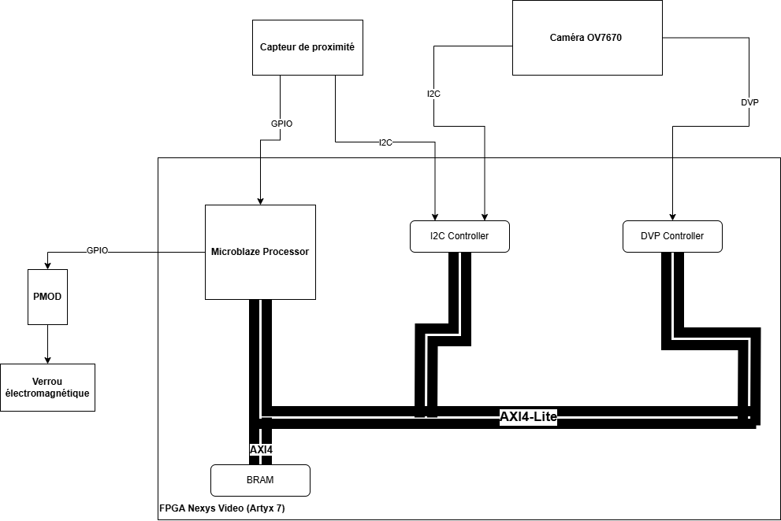

# FPGA Biometric Lock

A facial-recognition door lock on an FPGA: the **LBPH face-recognition algorithm in VHDL**, a **MicroBlaze** soft-core with **AXI4-Lite** peripherals, a proximity sensor and an electromagnetic lock, on a Digilent **Nexys Video** (Xilinx Artix-7).

> hepia (HES-SO Geneva) · FPGA Project · 2025
> Team project: **Adrian Spycher** & Valentin Bernillon
> 📄 [Report](docs/report-fr.pdf) · [Specification](docs/specification-fr.pdf) · [Slides](docs/presentation-fr.pdf) (French)

## Concept

<p align="center"></p>

1. A **VCNL4040 proximity sensor** (I²C) detects someone approaching and raises an **interrupt**.
2. An **OV7670 camera** captures the face.
3. The **LBPH** (Local Binary Pattern Histogram) algorithm, implemented in hardware, compares it with the authorised faces.
4. If the face is recognised, the **electromagnetic lock** is released.

## What was achieved

| Part | Status |
|---|---|
| Proximity sensor + lock – MicroBlaze, AXI I²C, GPIO interrupt, timer | ✅ working on the board |
| LBPH pipeline in VHDL – convolution, pixel encoding, histogram, comparison | ✅ validated in simulation (testbenches) |
| LBPH reference model in C | ✅ used to validate the hardware results |
| Camera configuration and VGA output | ⚠️ partially working – several test designs, not integrated |
| Full system (camera → LBPH → lock) | ❌ not integrated within the project time |

The report details the problems met with the camera and the VGA controller, and what a complete solution would need.

## Hardware design (VHDL)

The LBPH pipeline is split into small entities, validated with testbenches (`circuits/src/sim/`):

| Entity | Role |
|---|---|
| `lbph_conv` | streams the image, builds the 3 × 3 neighbourhood of each pixel and outputs its LBP value |
| `lbph_pixel_encoder` | compares the 8 neighbours with the centre pixel to produce the 8-bit LBP code |
| `lbph_histogram` | builds the histograms of the image regions |
| `lbph_comp` | computes the distance between the histogram and a reference one |
| `lbph` / `top` | assembly of the pipeline and top level |

The Vivado project and its block designs are generated from Tcl scripts – one design for the proximity sensor and the lock (`design_GPIO.tcl`), one for the camera and the VGA controller (`design_vga.tcl`).

## Software

- **`circuits/vitis_src/lock-proximity-demo/`** – the MicroBlaze demo: configures and reads the VCNL4040 over AXI I²C; its interrupt (AXI GPIO + interrupt controller) activates the lock output for 3 seconds, timed by an AXI timer that also blinks a heartbeat LED.
- **`circuits/vitis_src/01-…` to `06-…`** – successive Vitis test programs used to bring up the VGA output (colour test through GPIO, then a framebuffer in BRAM: corners, colour bands, border, stripes, column alignment).
- **`programs/`** – C reference model of LBPH (image transform, LBPH, Euclidean distance), used to check the hardware results.

## Build

```bash
cd circuits
make create-project   # recreate the Vivado project from the Tcl scripts
make open-project
```

Then `source` one of the block designs (`scripts/design_GPIO.tcl` or `scripts/design_vga.tcl`) in the Vivado Tcl console, and import the matching program from `vitis_src/` into Vitis. Requires Vivado / Vitis 2023 or later.

The C reference model builds with `make` in `programs/`.

## Project structure

```
├── circuits/
│   ├── src/hdl/         VHDL design (LBPH pipeline, top level)
│   ├── src/sim/         testbenches
│   ├── src/constraints/ Nexys Video pin constraints
│   ├── scripts/         Tcl scripts: project creation and block designs
│   └── vitis_src/       MicroBlaze programs (demo + VGA bring-up tests)
├── programs/            C reference model of LBPH
└── docs/                report, specification and slides (PDF), architecture diagram
```

## Tech

VHDL · Xilinx Vivado / Vitis · Artix-7 (Nexys Video) · MicroBlaze · AXI4-Lite · I²C · interrupts · Tcl · C · image processing (LBPH)

## Credits & license

Released under the [MIT license](LICENSE).
The Vivado Tcl helper scripts (`utils.tcl`, `prompt_colors.tcl`, and the base of `create_project.tcl`) are by Laurent Gantel (hepia).
